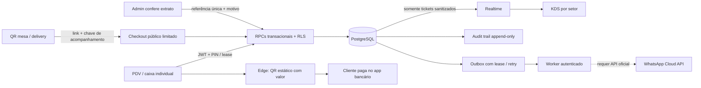
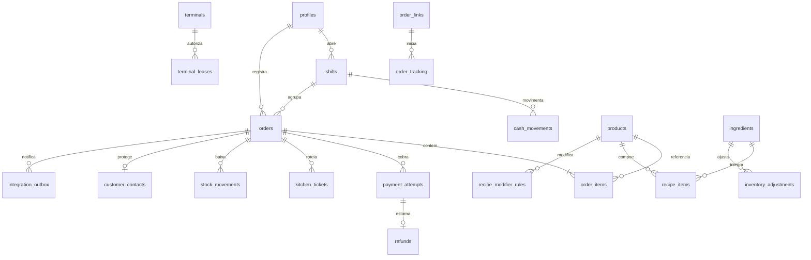

# Arquitetura atual

React usa Supabase Auth + PostgREST/RPC + Realtime. Python/SQLite anterior não participa da operação ativa. Custos, estoque, auditoria e contatos são protegidos no banco, independentemente de menu/rota no navegador.

## Módulos e fronteiras

**PDV:** produtos do banco, modificadores/observações por item, turno, contagem física, sangria/suprimento, fechamento com justificativa, total calculado pelo PostgreSQL, retomada de pedidos e cobrança. Dinheiro é confirmado pelo operador. Pix Nubank PF exige confirmação do administrador. TEF não processa enquanto não houver maquininha/serviço homologado.

**KDS:** recebe só tickets de setores autorizados depois do pagamento confirmado. Nome de contato vira `Pedido #N`; não existem preços, telefone, e-mail ou endereço no ticket. Estado/cores: fila, preparo, pronto; verde até 8 min, amarelo a partir de 8 e vermelho a partir de 15. Realtime reconecta e faz nova consulta; polling de 10 s reduz o impacto de eventos perdidos. Ao bloquear o terminal, o componente desmonta e remove a assinatura.

**Back-office:** produtos/receitas/insumos são editados por RPC auditada; alterações diretas pelo REST não têm permissão. Receita define consumo padrão; regras por modificador somam/subtraem quantidade de ingrediente. Consumo nunca fica negativo; revise regras sobrepostas. A liberação do pedido bloqueia produtos e insumos em ordem estável e grava movimentos únicos por venda/ingrediente. Pagamento não é apagado por saldo negativo: relatórios alertam a ruptura. Reservas preditivas/compra automática não são implementadas. Margens são estimativas de receita/custo padrão atual, não apuração contábil com impostos/taxas.

**Autoatendimento:** admin cria link com expiração e token de 256 bits, armazenado como hash no banco. Catálogo não expõe custos. Pedido recebe outro token aleatório de acompanhamento; o status revela apenas aquela cobrança/pedido, sem contatos. Há limite de pedidos por link, validação de preço/modificador no banco e idempotência. Pix/atendimento no caixa deve ser resolvido antes da cozinha. O token de mesa permite criar pedidos pendentes, não ler a base de clientes.

**Delivery:** dados privados separados; só admin e caixa atribuído ao pedido pago/ativo conseguem ler. Assumir atendimento exige turno aberto e gera auditoria. Despacho/entrega emitem eventos; contato deixa de aparecer ao funcionário após encerramento. Área/condições de entrega e taxas comerciais devem ser cadastradas/comunicadas pela loja antes de divulgar links; não inferimos preços de frete.

**WhatsApp:** implementação para API oficial (texto): desafio GET, HMAC-SHA256 do corpo bruto, validação do número comercial, deduplicação por ID, FAQ determinístico, inbox privado, atribuição e resposta de operador. Mensagens de mídia não são processadas pelo bot. Notificações por status exigem consentimento e janela/template aprovado. Usar apenas o aplicativo Business não habilita esses endpoints. Credenciais e configuração externa ainda são necessárias.

## Modelo relacional

Schemas privados guardam hashes dos terminais/PINs, tentativas, leases, tokens de links/acompanhamento, códigos de cobrança e jobs de mensagens. Não são expostos ao PostgREST. Triggers/definers usam `search_path=''`, nomes qualificados e grants explícitos. Novas funções não herdam EXECUTE público amplo.

## Consistência e reenvio

`create_order` soma preços canônicos em centavos, valida produtos/modificadores e não aceita preço do cliente. UUID de idempotência é único; corpo/pessoa divergente com a mesma chave é rejeitado. Falha de resultado desconhecido mantém rascunho e mesma chave. Comandos de ajuste/sangria/refund também preservam tentativa no terminal; não criar outra cobrança para resolver um timeout.

Confirmação financeira, baixa, tickets e outbox são atômicos. Nenhum ticket é criado apenas porque um QR foi exibido. Referência Pix manual é normalizada e única entre pagamentos, inclusive depois de estorno. Estorno é integral nesta versão; devolução física/bancária é conferida e registrada pelo admin. Não há reposição automática de alimentos estornados.

Fila usa `FOR UPDATE SKIP LOCKED`, lease de 2 min, backoff e limite de 8 falhas. Worker exige segredo server-side. Meta não fornece idempotência geral de envio: timeout após aceite pode duplicar notificação; isso não duplica pedido/pagamento/ticket. A interface avisa para conferir a conversa antes de reenviar uma resposta com resultado desconhecido.

## Perfis

| Perfil | Acesso |
| --- | --- |
| Anônimo | Catálogo/pedido/status por capacidade de link/acompanhamento; nenhuma tabela operacional ou contato |
| Caixa | PDV, próprio caixa/pedidos e atendimento atribuído; sem custos, descontos, estornos, analytics ou auditoria |
| Cozinha | KDS do setor com lease válida; nenhum valor ou contato |
| Admin | Gestão, ações autorizadas com motivo e leitura de auditoria; sem edição/exclusão de logs |
| Integração | RPCs mínimas; service role não recebe escrita livre nos registros financeiros/auditoria |

Ver [security.md](security.md) para limites de DDL/DBA, PIN 5/180 s, auto-lock de 10 min e LGPD. [activation.md](activation.md) distingue configuração disponível de integração realmente homologada.
