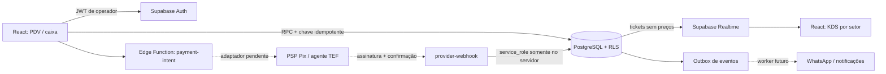
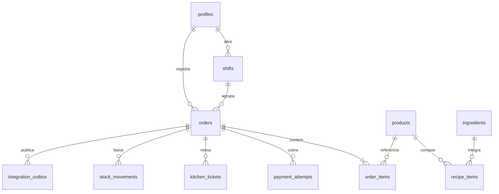

# Arquitetura e limites da entrega

Esta entrega implementa o **Módulo 1 inicial** e as fundações dos demais módulos. React + Supabase Auth/PostgreSQL/RLS/Realtime são a stack ativa. O servidor Python/SQLite anterior não é usado por esta versão e os seus dados não são migrados nem apagados automaticamente.

## Fronteiras e módulos

- **PDV:** imagens ilustrativas locais, busca, categorias (combos vazios até cadastro real), quantidades, modificadores inline, observações por item, turno próprio, total calculado no PostgreSQL. Rascunho e chaves de tentativa em sessionStorage por operador. Pedidos pendentes podem ser consultados/retomados do banco pelo próprio caixa; pedidos sem cobrança iniciada podem ser cancelados por comando explícito. O nome do cliente fica apenas nesse terminal até o envio; sair remove o rascunho. Não armazenar dados de cartões.
- **KDS inicial:** tickets por setor, somente depois do pagamento; reconexão automática do cliente Supabase, nova consulta ao reconectar, atualização por evento e polling a cada 10 s como fallback. Não é uma garantia de entrega exatamente uma vez do WebSocket: a consulta ao banco é a fonte da verdade. Verde <8 min, amarelo >=8 min, vermelho >=15 min. Os limites são uma configuração inicial, não métricas observadas da loja.
- **Back-office:** tabelas de ingredientes, fichas, movimentos imutáveis de venda e queries em `analytics.sql`. As telas são explicitamente fundações, não dashboards operacionais completos. Custos ficam fora do catálogo do caixa e dos tickets. Contas são criadas pelo Supabase Auth; administração de perfis e PINs pelo RPC/admin. Reembolsos, edição de vendas finalizadas e gestão completa de estoque precisam de comandos administrativos auditados próprios; não há uma API de reembolso simulada.
- **Autoatendimento:** contrato futuro abaixo. Não há rota pública com privilégio de criar pedidos nesta entrega. Dar `INSERT` a `anon` para acelerar o desenvolvimento violaria o isolamento.

## Modelo relacional

`profiles.id` referencia `auth.users`. Novas contas são **inativas e caixa**, independentemente de metadata enviada no cadastro. Só admin altera papel/setor/acesso com `manage_staff`; a função preserva ao menos um admin ativo e revoga leases de PIN. Definers têm search_path vazio, nomes qualificados, grants explícitos e não aceitam um `cashier_id` do navegador. Definers privados, credenciais PIN e eventos de webhook não são expostos no PostgREST.

| Identidade | Leituras e comandos |
| --- | --- |
| Anônimo | Nenhuma tabela de operação nem RPC de escrita. A prévia usa catálogo estático local e não simula transações. |
| Caixa ativo | Catálogo sem custos; com lease de PIN: próprio turno, próprios pedidos/itens/pagamentos; RPCs de operação. Sem visão de outro caixa. |
| Cozinha ativa | Apenas tickets do setor, sem preço, total, forma de pagamento ou custos; transições válidas do seu setor. |
| Admin ativo | Leitura de todas as tabelas operacionais; edição de catálogo/ingredientes/fichas; comandos explícitos. Não pode escrever arbitrariamente em registros financeiros imutáveis. |
| Service role | Servidor confiável para confirmação de PSP após verificação. Nunca no navegador, Vite ou preview. |

A proteção de rotas impede renderizar `/dashboard`, `/estoque`, `/relatorios`, `/equipe` a funcionários; `/pdv` só admin/caixa e `/cozinha` só admin/cozinha. RLS e grants continuam impedindo acessos diretos. Uma eventual URL digitada não muda o papel.

## PIN e terminais

E-mail/senha é a identidade primária do Supabase. PIN de quatro dígitos **não autentica uma nova pessoa**, nem troca o admin silenciosamente por um funcionário. Cada operador entra em sua conta e destrava seu próprio PDV. O hash bcrypt fica em schema privado; 5 erros geram bloqueio de 5 min, por usuário (não contornável trocando de aba/IP). Leases duram 15 min e são vinculados ao `session_id` do JWT. Bloquear revoga a lease no servidor quando a conexão permite confirmar o comando. Se a chamada falhar, a UI bloqueia localmente e avisa que a revogação no servidor não foi confirmada; a lease anterior expira em até 15 min. Alteração de PIN/papel também revoga. O banco valida a expiração mesmo com relógio local adulterado.

Supabase é responsável por senha, refresh tokens e validade do JWT. Ative MFA para administradores como etapa de produção. Para troca instantânea entre identidades sem senha em dispositivos compartilhados, será necessário um broker de terminais com credencial de dispositivo, registros de auditoria e tokens curtos; não é seguro converter um PIN de 4 dígitos em login público.

## Pagamentos, concorrência e quedas

1. `create_order` valida produtos ativos, quantidades e modificadores; busca preços na tabela, ignora preços enviados pelo cliente e soma em centavos. Lock de turno e de produtos protege concorrência com fechamento/alteração de preço.
2. Chave UUID de idempotência persiste no rascunho e é única no banco. Repetir mesmo corpo retorna o pedido existente; outro corpo/pessoa com a mesma chave é rejeitado. Em timeout de resultado desconhecido, os itens ficam congelados e o botão reenvia **a mesma tentativa**. Rejeições transacionais conhecidas permitem corrigir o rascunho.
3. Dinheiro: uma tentativa identifica o recebimento que o operador confirma manualmente. Confirmação é idempotente; nenhum valor digitado substitui o total. A tela de abertura/fechamento recebe apenas contagem de caixa, não valor de compra.
4. Pix/TEF: Edge Functions e contratos prontos, **adaptador não contratado/configurado**. Falham fechadas com 503 antes de criar cobrança. Não geram QR, aprovação TEF ou pagamento fictícios. QR só é renderizado para um `copyPaste` real do provedor.
5. Adaptador futuro usa valor persistido e UUID da tentativa como idempotency key no PSP. Webhook verifica assinatura nos bytes brutos, timestamp, conta recebedora e moeda, resolve identificador do PSP e consulta status canônico. Só depois chama `confirm_provider_payment`, restrito a service_role. Valor/duplicação/referência/evento são verificados no banco. Pagamento não pode ser confirmado por `paid=true` do frontend.
6. Confirmação e liberação para cozinha, baixa de estoque e outbox acontecem numa transação. Os setores recebem somente seus itens. Baixa por ficha ocorre uma vez. Saldo negativo reflete uma venda efetivamente paga; não se apaga uma confirmação financeira por ruptura. A consulta de baixos estoques identifica o problema. Reserva preventiva de insumos, substituições e bloqueio de produtos em ruptura são próximos passos antes de operar controle de estoque em produção.
7. O indicador de rede usa o navegador: rede disponível **não prova** que Supabase/PSP está acessível. Falhas das operações são exibidas, rascunho é preservado e retries são explícitos; nunca se repete uma cobrança sem chave. Não há fila offline que considere um pedido pago sem resposta do servidor.

**Ficha técnica:** a baixa inicial usa a receita padrão; “sem cebola” não altera automaticamente a ficha. Antes de usar estoque para planejamento, modelar diferenças de ingrediente por modificador. Não cadastramos receitas/estoques/custos inventados: os 20 g de milho do exemplo existem apenas nos testes de transação.

## Entradas automáticas e contratos futuros

- `POST /self-service/order`: Edge Function pública com catálogo seguro, token assinado de mesa/loja com expiração, limitação por IP/dispositivo e idempotência. O banco calcula total; aguarda pagamento antes de emitir ticket. Usar RPC própria, não impersonar um caixa do balcão com service_role.
- `POST /whatsapp/webhook`: validar desafio e assinatura da Meta nos bytes brutos, deduplicar ID da mensagem, validar origem/loja e inserir comando. Nunca executar instruções recebidas como SQL/ações administrativas.
- `integration_outbox`: consumidor futuro com `FOR UPDATE SKIP LOCKED`, envio com chave idempotente, retry exponencial + jitter, dead-letter após limite. Não adicionar tokens/telefone no evento de Realtime. Não existe worker enviando mensagens nesta entrega.
- TEF depende de agente/terminal homologado e rede/acesso do estabelecimento; navegador não acessa diretamente um PIN pad genérico. Dados sensíveis do cartão permanecem com o adquirente/terminal.

## Validação e limites

Testes SQL usam PostgreSQL real com roles `anon`, `authenticated` e `service_role` e stubs apenas do contrato `auth.uid/auth.jwt`. Validam RLS e lógica transacional; não comprovam Auth hospedado, push Realtime em rede, gateway financeiro, implantação Edge nem um Supabase remoto. Esses exigem projeto e serviços reais. Ver `deploy.md` para ativação e `tests/README.md` para comandos.
